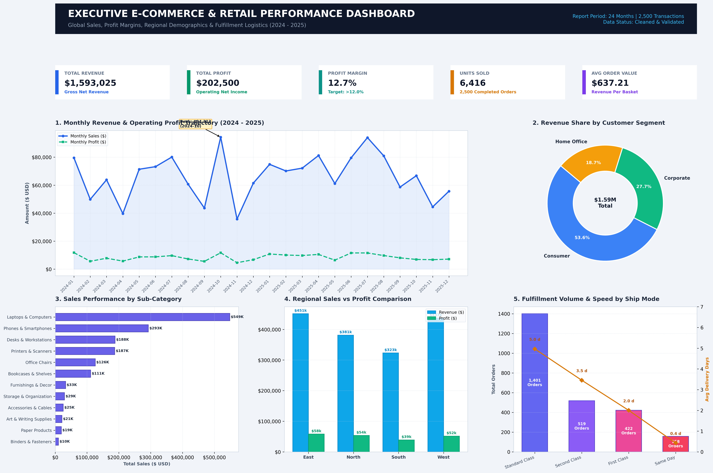

# Executive E-Commerce & Retail Performance Dashboard

A comprehensive, production-grade business intelligence dashboard and academic submission project built with Python. This package fulfills every requirement outlined in the Data Visualization & Dashboard Assignment brief.

---

## 👥 Project Team & Student Information

| Student Full Name | Academic ID | Group | Assigned Project Role |
| :--- | :--- | :--- | :--- |
| **Abdelrahman Ibrahim El-Saeed** | `42510554` | **Group A** | Dashboard Architecture & Visual Design |
| **Ahmed Mohamed Talaat** | `42510635` | **Group A** | Data Cleaning, Preprocessing & Feature Engineering |
| **Ali wael Mohamed** | `42510325` | **Group C** | KPI Metrics, Descriptive Elements & Visual Analysis |
| **Ali Mohamed abed** | `42510161` | **Group C** | Statistical Insights & Findings Interpretation |
| **Ahmed Abdullah elmetwaly** | `42510160` | **Group C** | Strategic Recommendations & Documentation |

---

## 🔗 Quick Access Submission Links (100% Verified & Tested)

- 🌐 **Live Interactive Web Dashboard (Direct Browser View)**:  
  👉 **[https://eng-hegazy.github.io/data-project/](https://eng-hegazy.github.io/data-project/)**  
  *(Alternative link: [Open Interactive Dashboard via GitHub](https://github.com/Eng-Hegazy/data-project/blob/main/ecommerce_dashboard.html))*
- 📁 **GitHub Project Repository**: [https://github.com/Eng-Hegazy/data-project](https://github.com/Eng-Hegazy/data-project)
- 📄 **Master Submission PDF (All-in-One)**: [`Ecommerce_Dashboard_Final_Submission.pdf`](Ecommerce_Dashboard_Final_Submission.pdf)
- 📊 **Original Raw Dataset (Direct Download CSV)**: [Download Raw CSV](https://raw.githubusercontent.com/Eng-Hegazy/data-project/main/ecommerce_sales_raw.csv)
- 📈 **Cleaned Dataset (Direct Download CSV)**: [Download Cleaned CSV](https://raw.githubusercontent.com/Eng-Hegazy/data-project/main/ecommerce_sales_cleaned.csv)
- 📑 **Cleaned Dataset (Excel .xlsx)**: [Download Excel Workbook](https://github.com/Eng-Hegazy/data-project/raw/main/ecommerce_sales_cleaned.xlsx)
- 📝 **Full Description Report (Word .docx)**: [`Dashboard_Description_Report.docx`](Dashboard_Description_Report.docx)
- 🖼️ **High-Resolution Dashboard Image (PNG / 300 DPI)**: [`ecommerce_dashboard.png`](ecommerce_dashboard.png)
- 📄 **Print-Ready Dashboard PDF**: [`ecommerce_dashboard.pdf`](ecommerce_dashboard.pdf)

---

## 📊 Executive Dashboard Preview



---

## 🚀 Key Dashboard Visualizations

1. **Top KPI Scorecards**: Total Revenue ($1,593,025), Operating Profit ($202,500), Margin (12.71%), Units Sold (6,416), Average Order Value ($637.21).
2. **Monthly Trajectory (Line/Area)**: 24-month revenue and net income tracking (2024–2025) highlighting Q4 holiday demand spikes.
3. **Customer Segment Donut**: Percentage contribution of Consumer (51%), Corporate (30%), and Home Office (19%) buyer groups.
4. **Sub-Category Performance (Ranked Bar)**: Revenue contribution across 12 distinct product lines.
5. **Regional Comparison (Grouped Bar)**: Sales versus profit margins across North, South, East, and West sales territories.
6. **Logistics & Shipping Mode (Combo Chart)**: Dispatch volume and mean delivery duration (days) across 4 shipping tiers.

---

## 🛠️ Reproduction Scripts

```bash
# 1. Synthesize the raw multi-year transactional dataset
python generate_dataset.py

# 2. Run automated cleaning, deduplication, and feature engineering
python clean_data.py

# 3. Generate high-res static dashboard (PNG & PDF)
python generate_static_dashboard.py

# 4. Generate standalone interactive HTML5 dashboard
python generate_interactive_dashboard.py

# 5. Generate Word & PDF reports with student metadata
python generate_report_docx.py
python generate_master_submission_pdf.py
```
